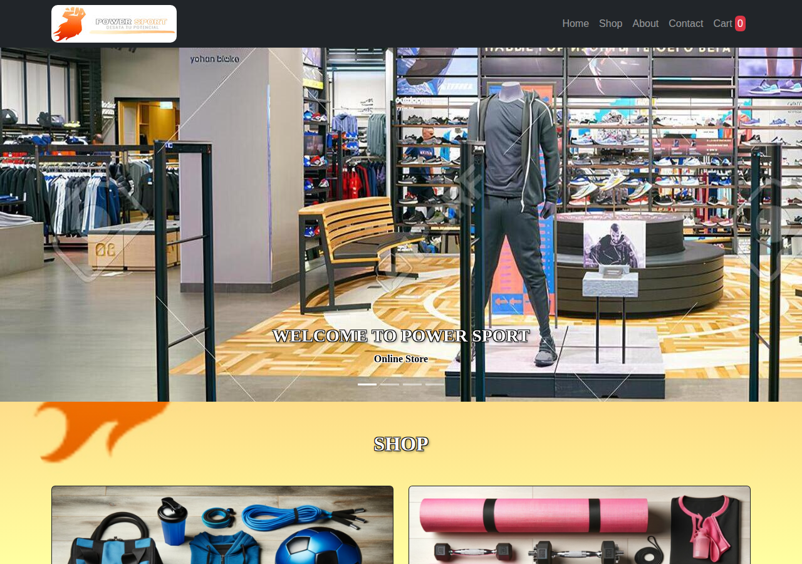

# Power Sport

Simulación de una tienda de indumentaria deportiva, armada como portfolio. No procesa pagos.

Al confirmar una compra, el backend envía un correo de confirmación por Brevo. El frontend repone el stock a propósito, para que los productos sigan disponibles y la tienda se pueda volver a probar.

## Stack

- Este repo: Next.js 14, React 18 y Bootstrap 5.
- API: Express y MongoDB, en [ProyectoBackendServer](https://github.com/simondelasheras/ProyectoBackendServer).

## Qué se puede hacer

- Recorrer la home y el shop.
- Ver un producto, elegir cantidad y agregarlo al carrito.
- Quitar una unidad o el ítem entero.
- Confirmar la compra con un email. El carrito queda vacío y el stock vuelve.

Si un producto tiene `countInStock` en 0, el botón pasa a "Out of Stock".

## Cómo ejecutarlo

Hacen falta los dos repos y una base MongoDB local. Las dependencias de este repo se instalan con npm, usando `package-lock.json`.

### 1. MongoDB

Levantá un MongoDB en la máquina. La URI va en el backend, en la variable `CONNECTION_STRING`. El archivo de ejemplo del backend trae el nombre de las variables, sin claves.

### 2. Backend

```bash
git clone https://github.com/simondelasheras/ProyectoBackendServer
cd ProyectoBackendServer
cp .env.example .env
npm install
npm start
```

En `.env` completá `CONNECTION_STRING`. Para que el correo salga, también `BREVO_SMTP_HOST`, `BREVO_SMTP_PORT`, `BREVO_SMTP_LOGIN`, `BREVO_SMTP_KEY` y `BREVO_FROM_EMAIL`. El remitente tiene que estar autorizado en Brevo. Si faltan usuario, clave o remitente, la compra responde 503 y no envía nada.

El proceso abre tres puertos:

| Puerto | Recurso |
| --- | --- |
| 5050 | `/api/products` |
| 8080 | `/api/carts` |
| 9090 | `/api/buy` |

`PORT` puede listarlos juntos: `5050,8080,9090`.

### 3. Productos

`utils/db.json` es el catálogo de ejemplo. La tienda no lo lee: los productos salen de `GET /api/products`.

Para cargarlo en la base del backend, insertá el arreglo `products` en la colección `products`. El campo numérico `id` no forma parte del modelo; se puede omitir. Mongoose asigna `_id`.

### 4. Frontend

```bash
npm ci
npm run dev
```

Abrí http://localhost:3000. El backend solo acepta ese origen.



## Pendiente para publicarla

Hoy el frontend llama a `localhost` en los puertos 5050, 8080 y 9090. Para subirla haría falta hospedar el backend, una base MongoDB, las variables `CONNECTION_STRING` y `BREVO_*`, un remitente verificado en Brevo, CORS para el dominio del sitio y que el frontend use la URL pública del backend. `eslint-config-next` sigue en la versión 12, con Next 14. Nada de eso entra en este repo todavía.
